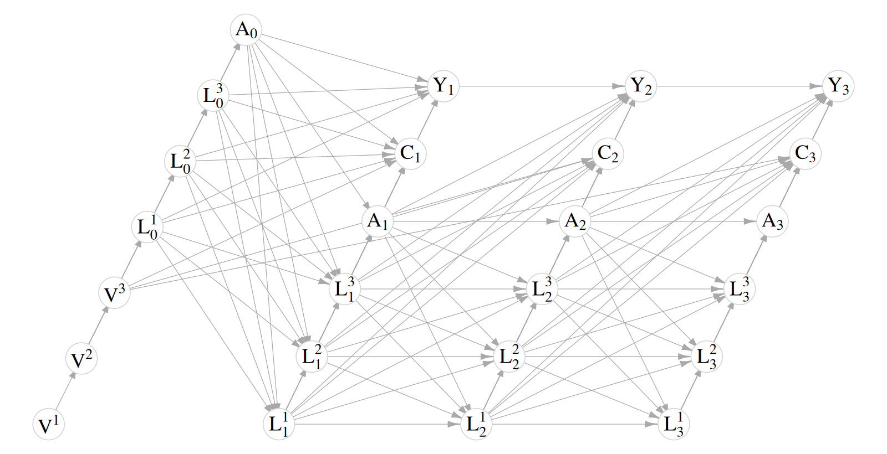
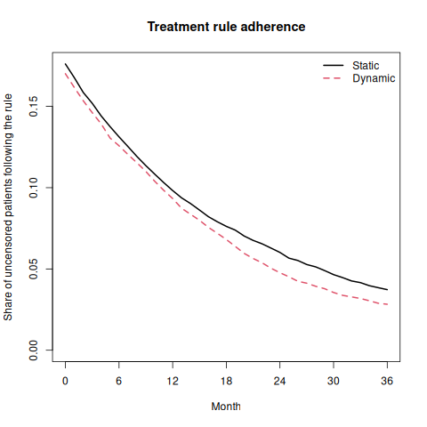
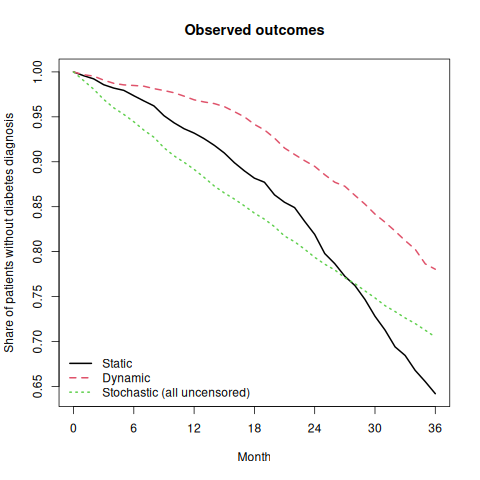
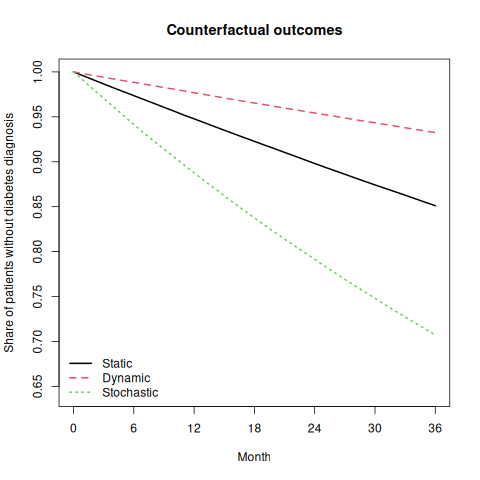
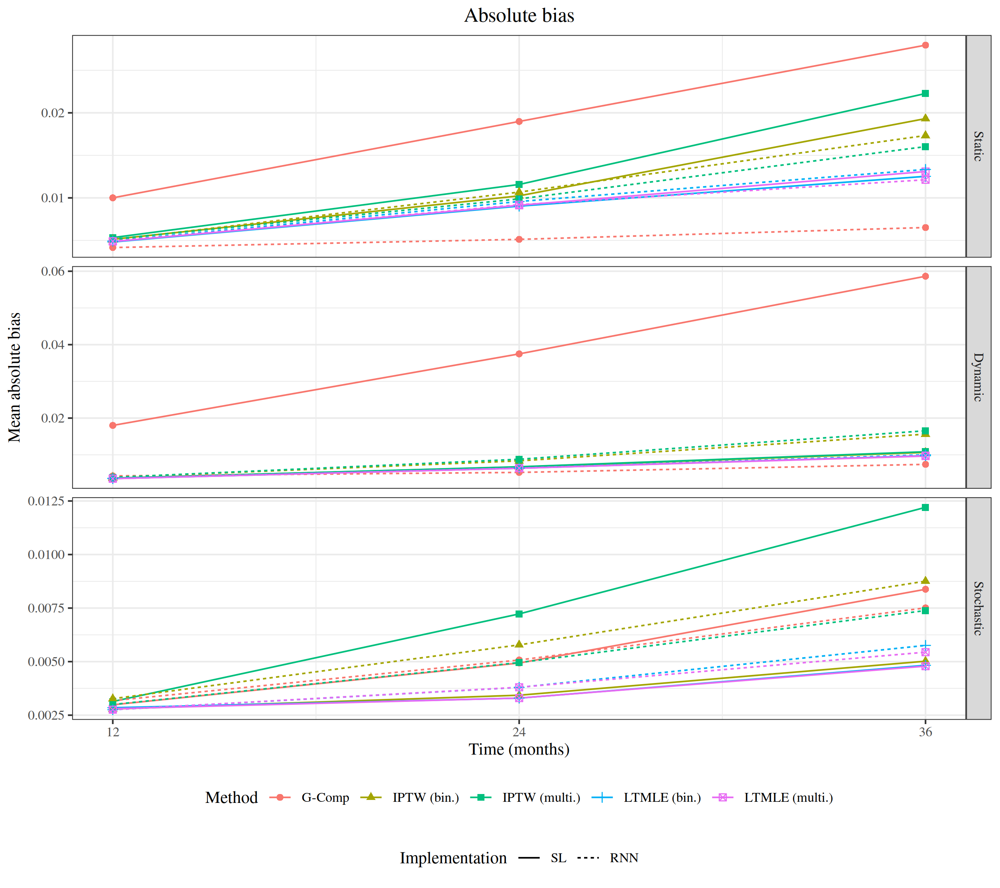
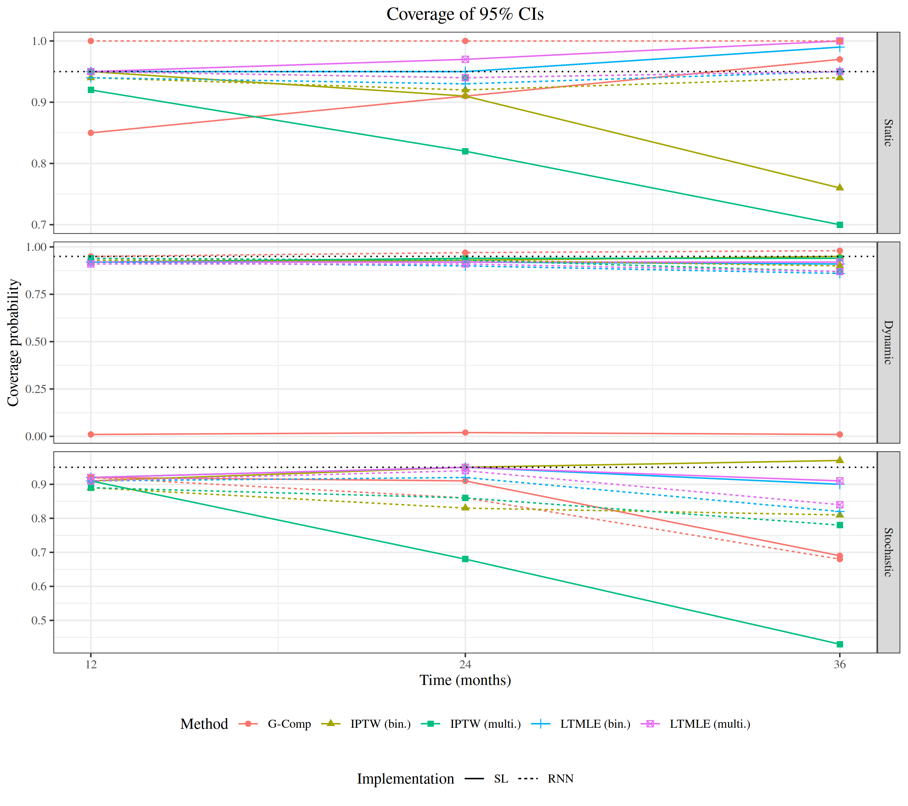
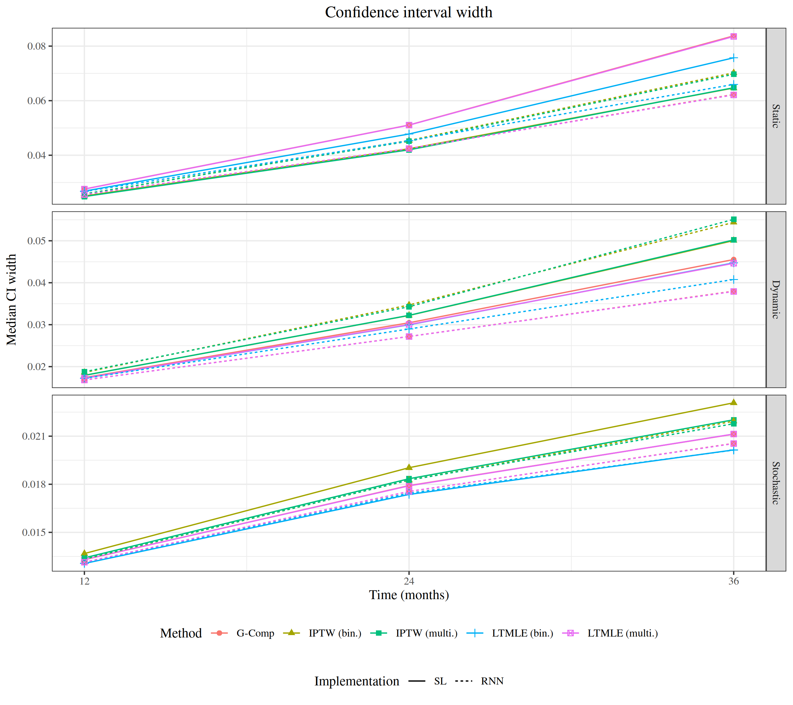

# multi-ltmle

Simulation code for longitudinal targeted minimum loss-based estimation (LTMLE) with
multi-valued treatment regimes, using Super Learner (SL) or recurrent neural networks (LSTMs)
as learners for the outcome, treatment and censoring models.

Please cite the following paper if you use this repository:

```
@unpublished{poulos2026doubly,
  title  = {Doubly-robust causal inference for multi-valued treatment regimes with recurrent
            neural networks},
  author = {Poulos, Jason},
  year   = {2026},
  note   = {Working paper}
}
```

The simulation compares, for static, dynamic and stochastic treatment rules, the cumulative
event probability psi_t = E[Y_t^d] at months t = 12, 24 and 36 estimated by

* LTMLE with a multinomial treatment model or with separate binomial (one-vs-rest) models,
* Hajek IPTW with either treatment model, and
* sequential g-computation,

each with SL learners (`estimator = 'tmle'`) or LSTM learners (`estimator = 'tmle-lstm'`),
over 100 simulated datasets of n = 10 000 patients.

Requirements
------

The results in the paper were produced on Ubuntu 26.04.1 (x86_64, a laptop with a 4-core Intel
Core i7-8550U CPU, no GPU) with

* **R** 4.5.2 and the package versions in `session_info.txt` (output of `sessionInfo()` from
  the simulation run). Install the packages with `Rscript package_list.R`, which installs the
  CRAN packages and pins the three GitHub packages to the commits used:
  `sl3` 1.4.5 (`tlverse/sl3@0e8f236`), `simcausal` 0.5.5 (`osofr/simcausal@bce5ad7`) and
  `Rsolnp` 1.16 (`jvpoulos/Rsolnp@16049fb`).
* **Python** 3.10.12 with the packages in `requirements.txt` (TensorFlow 2.18.0, Keras 3.7.0,
  NumPy 2.0.2), needed only for the LSTM learners. The code expects a virtual environment in
  `./myenv`:
  ```bash
  python3.10 -m venv myenv
  source myenv/bin/activate
  pip install -r requirements.txt
  ```
  Python is called from R through `reticulate` (`src/lstm.R`); TensorFlow runs on the CPU.

All commands below are run from the repository root. No manual edits of the code are needed.

Files
------

| File | Contents |
|------|----------|
| `run_simulation.sh` | Runs the simulation study (calls `simulation.R`). |
| `simulation.R` | Driver: settings, packages, the replicate loop; skips replicates already saved. |
| `long_sim_plots.R` | Tables and figures of the paper from the saved per-replicate results. |
| `diagnostic_gcomp_sl.R` | Diagnostic of the bias of G-Comp-SL under the dynamic rule (simulation results). |
| `package_list.R` | Installs the R packages (GitHub packages pinned to the commits used). |
| `requirements.txt` | Python packages for the LSTM learners. |
| `session_info.txt` | `sessionInfo()` of the R session that produced the results. |
| `src/simulation_fns.R` | `simLong()`: simulates one dataset and applies all estimators (one replicate). |
| `src/simcausal_dgp.R` | Data-generating process (DGP) as a `simcausal` DAG. |
| `src/simcausal_fns.R` | Distribution functions of the DGP, the treatment rules and the large-n truth (`compute_truth()`). |
| `src/tmle_fns.R` | LTMLE core: treatment and censoring models, clever-covariate weights, the backward recursion (LTMLE, IPTW, g-computation). |
| `src/tmle_IC.R` | Influence-curve-based standard errors and confidence intervals. |
| `src/SL3_fns.R` | Super Learner libraries and metalearners (`sl3`). |
| `src/lstm.R` | R bridge to the LSTM learners. |
| `src/utils.py`, `src/train_lstm.py`, `src/test_lstm.py` | LSTM architectures and hyperparameters (`HP`), training, and prediction. |
| `src/plotDAG_improved.R` | DAG plot of the DGP (Figure A1). |
| `data/truth_t_36_n_1e+05_seeds_5.rds` | Cached true values psi_t (see below). |
| `outputs/sl_n10000_t12-24-36/`, `outputs/rnn_n10000_t12-24-36/` | Per-replicate results of the simulation runs in the paper (100 replicates each). |
| `tables/` | Tables generated by `long_sim_plots.R` from `outputs/`. |
| `sim_results/` | Figures generated by `long_sim_plots.R` from `outputs/`. |

Reproducing the results
------

### 1. Simulation runs (optional; intermediate results are included)

```bash
./run_simulation.sh tmle 3 TRUE 100 "12,24,36" ./outputs/sl_n10000_t12-24-36
./run_simulation.sh tmle-lstm 3 TRUE 100 "12,24,36" ./outputs/rnn_n10000_t12-24-36
```

Arguments: estimator (`tmle` = SL learners, `tmle-lstm` = LSTM learners), cores used within a
replicate, use SL (`TRUE`; `FALSE` uses GLM / multinomial logistic regression, `tmle` only),
number of replicates R, target times (`all` = 1..36, or a comma-separated list), output
directory, and optionally a subset of replicates (e.g. `1:25` or `7`).

Each replicate r is saved as its own `.rds` file in the output directory. A run that is
interrupted resumes where it stopped (replicates already saved are skipped), and disjoint
ranges of replicates can run as separate processes writing to the same directory.

On the 4-core laptop above, with 3 cores per replicate, a replicate took a median of 56 minutes
with SL (95 hours for 100 replicates) and 25 minutes with LSTMs (43 hours). To reduce the run
time, run fewer replicates (R), fewer target times, or ranges of replicates in parallel on
several machines.

### 2. Spot checks of single replicates

A single replicate can be re-run without re-running the study, e.g. replicate 7 of the SL run
(about an hour) or of the LSTM run (about 25 minutes):

```bash
./run_simulation.sh tmle 3 TRUE 100 "12,24,36" ./outputs/spotcheck_sl 7
./run_simulation.sh tmle-lstm 3 TRUE 100 "12,24,36" ./outputs/spotcheck_rnn 7
```

```r
f <- function(d) readRDS(list.files(d, pattern = "_r_7_", full.names = TRUE))$metrics
all.equal(f("outputs/spotcheck_sl"), f("outputs/sl_n10000_t12-24-36"))
all.equal(f("outputs/spotcheck_rnn"), f("outputs/rnn_n10000_t12-24-36"))
```

All random numbers are seeded by the replicate number r (the simulated data, the learners and
the cross-validation folds), so a replicate's results do not depend on the other replicates or
on the order in which they are run. With the SL learners, the results are identical for any
number of cores of 2 or more; with 1 core, the learners run in the main R process and draw
different (equally valid) random numbers.

### 3. Tables and figures

```bash
Rscript long_sim_plots.R outputs/sl_n10000_t12-24-36 outputs/rnn_n10000_t12-24-36 --dgp-figures
```

This takes under a minute and writes (file name = number in the paper; "S" = Supporting
Information):

| Output | In the paper |
|--------|--------------|
| `tables/Table1_results_estimator.tex` | Table 1 |
| `tables/Table2_results_rule.tex` | Table 2 |
| `tables/TableS2_results_estimator_rule.tex` | Table S2 |
| `tables/TableS3_positivity.tex` | Table S3 |
| `tables/monte_carlo_se.csv` | Monte Carlo standard errors of the summaries in Table S2 |
| `tables/TableS4_run_times.tex` | Table S4 (computation time per replicate) |
| `tables/run_times.csv` | Computation times of each replicate |
| `sim_results/FigureA1_DAG.png` (`.pdf`) | Figure A1 |
| `sim_results/FigureS1a_treatment_adherence.png`, `FigureS1b_survival_observed.png`, `FigureS1c_survival_truth.png` | Figure S1 |
| `sim_results/FigureS2a_bias.png`, `FigureS2b_coverage.png`, `FigureS2c_ci_width.png` | Figure S2 |

Figure 1 (estimator diagram) is drawn in LaTeX, and Table S1 lists the learner
hyperparameters set in `src/SL3_fns.R` and `HP` in `src/utils.py`. The DGP figures
(`--dgp-figures`) simulate one dataset (replicate 1) and use the cached truth.

### 4. Diagnostic of G-Comp-SL

```bash
Rscript diagnostic_gcomp_sl.R 1 36 dynamic
```

This repeats the g-computation recursion for the dynamic rule at t = 36 in replicate 1, once with
SL and once with main-terms logistic regressions as the outcome models (about 2 minutes, one
core), and writes `tables/gcomp_sl_diagnostic_steps.csv` (per backward step: SL ensemble
weights, mean pseudo-outcome, and the mean change in predicted risk from setting the treatment
to the rule under each learner) and `tables/gcomp_sl_diagnostic_summary.csv` (the two estimates,
the truth, the mean ensemble weights and the ratio of the changes in predicted risk, SL to
logistic regression).

Model Weights, Intermediate Results, and Visualizations
------

### Model weights

The LSTMs (treatment, censoring and outcome models) are refit in memory for every replicate,
and their weights are not saved. The
architectures and hyperparameters are in `HP` in `src/utils.py`; the number of training epochs
of the treatment and censoring LSTMs is saved in each replicate's results (`lstm_epochs`).
The Super Learners are also refit in every replicate and not saved; for the g-computation
outcome regressions of one replicate, `diagnostic_gcomp_sl.R` saves the ensemble weights (see
above).

### Intermediate results

* `outputs/sl_n10000_t12-24-36/` and `outputs/rnn_n10000_t12-24-36/`: one file per replicate,
  `longitudinal_simulation_results_estimator_<tmle|tmle-lstm>_treatment_rule_all_r_<r>_n_10000_J_6_n_folds_3_scale_continuous_FALSE_use_SL_TRUE.rds`,
  a list with
  * `metrics`: one row per estimator, rule and target time with the estimate (`est`), its
    standard error (`se`), the true value (`truth`), the 95% CI (`lower`, `upper`), `bias`,
    `abs_bias`, CI coverage (`cover`) and width (`ciw`);
  * `positivity`: per treatment model, rule and target time, the numbers of uncensored subjects
    at risk and of rule-followers, and the share of followers whose estimated cumulative
    probability of following the rule is below 0.025;
  * `failures` (failed model fits), `timings`, `elapsed_time`, `lstm_epochs` and the settings
    (`n`, `J`, `t.end`, `target_times`, `gbound`, `ybound`, `n_folds`, `use_SL`).
* `data/truth_t_36_n_1e+05_seeds_5.rds`: the true psi_t for t = 1..36 under each rule, the mean
  over 5 counterfactual samples of 100 000 patients simulated under the rule (seeds
  1 000 001 to 1 000 005), with its Monte Carlo standard error. `compute_truth()` reuses this
  file while `src/simcausal_dgp.R` is unchanged (MD5 checksum) and recomputes it otherwise.
* `tables/monte_carlo_se.csv`: Monte Carlo standard errors of the mean absolute bias, coverage
  and CI width by estimator and rule (standard deviation of the replicate means / sqrt(R)).
* `tables/run_times.csv`: per replicate, the total wall-clock time and the wall-clock and CPU
  time (including the worker processes) of the treatment and censoring models (`g_C_*`) and of
  the outcome regressions (`Q_*`), in minutes, from each replicate's `timings` and
  `elapsed_time`.

### Visualizations

DAG of the DGP for t = 0..3 (Figure A1):



Treatment-rule adherence and observed and counterfactual outcomes in one simulated dataset
(Figure S1):

| Adherence | Observed outcomes | Counterfactual outcomes |
|-----------|-------------------|-------------------------|
|  |  |  |

Absolute bias, coverage and CI width of the estimators over time (Figure S2):




